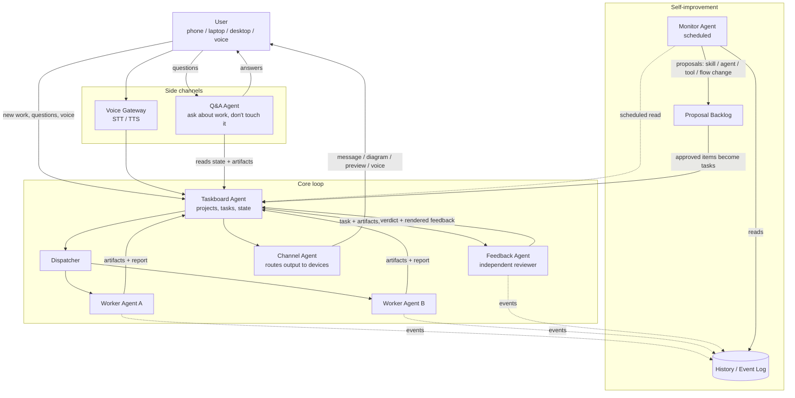

# Agent Workflow — v1 Design

> Draft, first version. Describes the agents, the flow between them, and the data each one owns.
> Open questions and deliberate v1 simplifications are marked with **[Q]** and **[v1]**.

## 1. Overview

## 2. Core loop

The daily cycle a task travels through:

1. **Intake** — You drop work into the taskboard agent (text, email forward, voice note).
   It creates or updates a task in the right project and asks clarifying questions if the
   intent is ambiguous.
2. **Dispatch** — The dispatcher picks the right worker agent for each ready task
   (by capability, load, and past success rate), hands over a self-contained brief,
   and marks the task `in_progress`.
3. **Work** — A worker agent executes the task in its own context. It is *blind* to the
   feedback pipeline: it only sees its brief and the artifacts it produces.
4. **Feedback** — A feedback agent (never the worker, never sharing its context) receives
   the finished artifacts plus the original brief. It checks the work against the brief,
   produces a verdict (`pass` / `pass with notes` / `fail`), and renders the feedback in
   whatever form fits: a short message, a rendered diagram, a website preview link, a voice note.
5. **Delivery** — The channel agent routes the verdict and feedback to you on whichever
   device/channel you told it to use.
6. **Close or loop** — On `pass`, the task is marked `done` and artifacts are archived.
   On `fail` or `pass with notes`, it goes back to the dispatcher with the feedback attached,
   usually to the *same* worker (continuity) with a bounded retry count.

## 3. Agents

### 3.1 Taskboard Agent — *the source of truth*

Owns: the task store, the project list, task state machine.

- Data model **[v1]**: projects → tasks → subtasks. Each task has: brief, status
  (`backlog / ready / in_progress / in_review / changes_requested / done / blocked`),
  assigned worker, artifacts, feedback history, and links to related events in the history log.
- Accepts work from: you, the Q&A agent (as suggestions), the monitor agent (improvement tasks),
  and feedback agents (rework loops).
- Answers any agent asking "what should I do next?" and "what is the state of X?".
- Handles ambiguity by asking you questions *before* dispatch, not after.
- **[v1]** Storage: a plain file store (markdown/JSON, git-friendly) so the whole system
  stays inspectable and diffable. A real database is a later decision.

### 3.2 Dispatcher

Owns: the assignment decision.

- Matches tasks to workers by declared capabilities, current load, and (later) measured
  success rate per task type.
- Writes a self-contained brief per task: goal, constraints, done-criteria, artifact format,
  retry budget.
- Handles the rework loop: re-dispatch with the feedback agent's notes attached.

### 3.3 Worker Agents

Owns: nothing shared — private context, produce artifacts.

- Domain-flavored executors: coding, research, writing, planning, data wrangling, ...
- One agent per running task **[v1]**; no shared memory between workers.
- Report back: artifacts + a short self-report (what was done, known limitations,
  where to verify). The self-report is input for the feedback agent, not a verdict.
- Must not see feedback on their own work until a rework loop hands it to them —
  keeps self-grading and defensiveness out of the loop.

### 3.4 Feedback Agent — *independent by construction*

Owns: the review verdict and the rendered feedback.

- **Decentralization rule:** the feedback agent runs in its own context, is a *different*
  agent identity than the worker, and receives only the brief + artifacts — never the
  worker's reasoning or self-report as truth.
- Produces: verdict, findings, and feedback rendered in the form that fits:
  - **Message** — short summary for quick triage.
  - **Diagram** — architecture/flow rendering of what was built or decided.
  - **Website preview** — live preview link of the result (for web work).
  - **[v1]** forms are pluggable; the channel agent decides how to deliver each.
- Severity model **[v1]**: `blocking` (fail, rework), `suggestion` (pass with notes),
  `observation` (log only).

### 3.5 Channel Agent

Owns: delivery routing and device registry.

- Knows your devices and preferred channels: phone (messaging app / push), laptop,
  desktop (dashboard / local notification), and voice out anywhere.
- Renders machine feedback into channel-appropriate form (e.g. turns a verdict into a
  20-second voice note for the phone).
- One task notification policy **[v1]**: configurable per project — notify on every state
  change, digest only, or notify only when a human decision is needed.

### 3.6 Q&A Agent — *questions without interruption*

Owns: nothing; read-mostly access.

- You ask questions about ongoing or finished work ("why did the worker pick Postgres?",
  "what's left on project X?") without messaging the worker directly.
- Reads taskboard state, artifacts, and history — workers are never paused or poked by it.
- Can route a question *to* the taskboard as a clarification (which may trigger a pre-dispatch
  question), but it never edits running work.

### 3.7 Voice Gateway

Owns: speech I/O.

- **In:** voice notes / calls transcribed (STT) and handed to the right entry point
  (new task → taskboard, question → Q&A agent).
- **Out:** TTS for any feedback or answer; a first-class channel of the channel agent.
- **[v1]** phone voice calls are out of scope; voice = recorded notes and TTS playback
  on devices.

### 3.8 Monitor Agent — *the self-improvement loop*

Owns: the history/event log, the proposal backlog.

- **Runs on a schedule** (cron), not in the live task loop — it observes from outside.
- **History:** every agent emits structured events (task created, dispatched, failed,
  retried, feedback verdict, cycle time, your interventions). The monitor reads this stream.
- **Analysis:** looks for friction patterns — tasks that repeatedly fail feedback,
  long cycle times, questions you keep asking that the system should have answered
  proactively, workers with low success on certain task types.
- **Proposals:** when a pattern is found, it files a proposal in the backlog:
  - a new **skill** (a reusable capability for existing agents),
  - a new **agent** (a capability gap no worker covers),
  - a new **tool** (integration with something external),
  - a **flow change** (e.g. "add a second feedback pass for type X").
- **Human gate **[v1]**:** proposals never auto-apply. They appear as tasks in a
  dedicated `improvements` project on the taskboard; you approve, modify, or reject them.
  On approval they are dispatched like any other task (often built by a worker agent).

## 4. Cross-cutting concerns

### 4.1 Event log (shared, append-only)

The spine of self-improvement. Structure **[v1]**: JSONL events with
`{ts, actor, event_type, task_id, project_id, payload}`.
Written by taskboard, workers, feedback, and channel agent; read by monitor and Q&A.

### 4.2 Feedback decentralization guarantees

- Different agent identity and context than the worker.
- Input = brief + artifacts only.
- Worker never sees feedback unless dispatched for rework.
- Verdicts are logged, so the monitor can score feedback quality too
  (e.g. feedback agents whose `fail` verdicts you keep overriding).

### 4.3 Failure & retry policy **[v1]**

- Worker crash → task back to `ready`, dispatcher re-runs with a fresh brief.
- Feedback `fail` → `changes_requested`, bounded retries (default 3), then escalates to you.
- Monitor does not act on live failures; it only sees them in the log.

## 5. Open questions

- **[Q]** Which messaging channels first? (Telegram, Discord, WhatsApp, plain email?)
- **[Q]** Where does the system itself run — always-on box, laptop, cloud?
- **[Q]** Do you want the Q&A agent to also answer from the history log (cross-project memory),
  or only from live taskboard state in v1?
- **[Q]** Should approved improvement tasks be allowed to modify the monitor agent itself?

## 6. Suggested build order

1. Taskboard agent + file store (everything else depends on it).
2. One worker agent + dispatcher on a single project — prove the core loop.
3. Feedback agent + channel agent (message form first).
4. Q&A agent.
5. Event log + monitor agent with a weekly schedule.
6. Voice gateway, extra channels, extra feedback forms, more workers.
