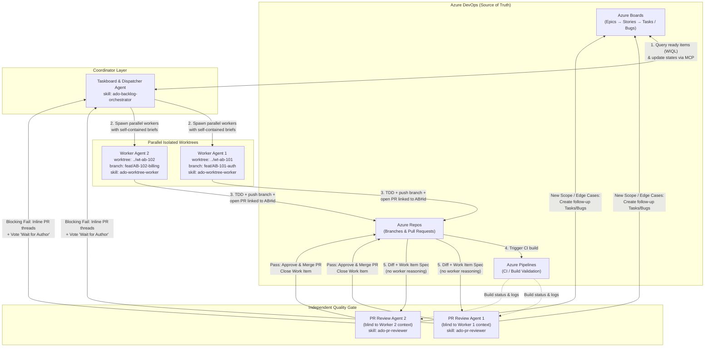

# Azure DevOps Parallel Agent Development Flow

> Concrete implementation of [FLOW.md](FLOW.md) for software engineering teams using **Azure DevOps (Boards + Repos + Pipelines)**, **Git Worktrees**, and **Parallel Subagents**.

---

## 1. End-to-End Architecture



---

## 2. Installed Skillset Stack

This repository bundles three specialized skills under [`.agents/skills/`](.agents/skills/) combining patterns from [`microsoft/azure-devops-skills`](https://github.com/microsoft/azure-devops-skills) and [`obra/superpowers`](https://github.com/obra/superpowers):

| Skill | Agent Role | Core Responsibilities |
| :--- | :--- | :--- |
| [`ado-backlog-orchestrator`](.agents/skills/ado-backlog-orchestrator/SKILL.md) | **Taskboard + Dispatcher** | Polls Azure Boards via MCP/CLI, resolves dependency order, builds self-contained briefs, dispatches parallel workers and reviewers, and loops until the backlog is empty. |
| [`ado-worktree-worker`](.agents/skills/ado-worktree-worker/SKILL.md) | **Parallel Worker Agent** | Provisions an isolated Git worktree (`../wt-ab-<id>`), runs strict Red-Green-Refactor TDD, pushes `feat/AB-<id>-<slug>`, opens/updates the ADO Pull Request, and handles rework comments. |
| [`ado-pr-reviewer`](.agents/skills/ado-pr-reviewer/SKILL.md) | **Independent Feedback Agent** | Reviews the PR diff solely against the ADO Work Item acceptance criteria in a clean context. Approves/merges, requests rework via inline PR threads, or creates new backlog items for discovered scope. |

---

## 3. Prerequisites & MCP Configuration

### 3.1 Azure DevOps MCP Server
The agents communicate with Azure DevOps primarily through Microsoft's official [`@azure-devops/mcp`](https://github.com/microsoft/azure-devops-mcp) server.

Add the following to your global `~/.gemini/config/mcp_config.json` (or workspace plugin config):

```json
{
  "mcpServers": {
    "azure-devops": {
      "command": "npx",
      "args": [
        "-y",
        "@azure-devops/mcp",
        "<YOUR_ADO_ORG_NAME>"
      ],
      "env": {
        "ADO_PAT": "<YOUR_PERSONAL_ACCESS_TOKEN>"
      }
    }
  }
}
```

> [!TIP]
> If you are signed in via Azure CLI (`az login` with the `azure-devops` extension installed), `@azure-devops/mcp` can authenticate interactively or via Entra ID without requiring a static PAT.

### 3.2 Required PAT Scopes
If using a Personal Access Token, grant least-privilege scopes per role:
- **Work Items:** `Read & Write` (querying WIQL, updating state, creating follow-up tasks/bugs)
- **Code:** `Read, Write, & Manage` (pushing branches, creating PRs, posting PR threads, voting, completing PRs)
- **Build:** `Read` (inspecting CI pipeline validation results on PRs)

---

## 4. The Continuous Backlog-to-Merge Loop

### Phase 1: Backlog Triage & Wave Planning (`ado-backlog-orchestrator`)
1. **Query Ready Queue:** The orchestrator runs a WIQL query for Work Items in `New` / `Ready` / `Approved` (or `Active` with `changes_requested` tag) ordered by `System.VSTS.Common.Priority` and `System.VSTS.Common.StackRank`.
2. **Dependency & Collision Filter:**
   - Excludes items blocked by unfinished `Predecessor` links.
   - Groups independent items into a **parallel wave** (default max concurrency: `3–5` workers) that do not touch the exact same files/modules.
3. **Brief Generation:** For each item in the wave, the orchestrator compiles a self-contained brief containing:
   - Work Item ID (`AB#<id>`), Title, Description, Acceptance Criteria, and Repro Steps.
   - Target base branch (e.g., `main`) and assigned worktree branch (`feat/AB-<id>-<slug>`).
   - If re-dispatching after a failed review: the unresolved inline PR review threads.

### Phase 2: Isolated Worktree Implementation (`ado-worktree-worker`)
1. **Worktree Isolation:**
   - Either spawned via Antigravity `invoke_subagent` / `swarm` with `Workspace: "share"`, or via the helper script [`manage-worktree.ps1`](.agents/skills/ado-worktree-worker/scripts/manage-worktree.ps1):
     ```powershell
     .\.agents\skills\ado-worktree-worker\scripts\manage-worktree.ps1 -Action create -WorkItemId 1234 -Slug "user-export"
     ```
2. **Port & Env Isolation:** Copies untracked local config (`.env.example` → `.env`) and offsets any local dev/test server port by `1000 + (WorkItemId % 1000)` to prevent parallel port collisions.
3. **TDD Implementation:**
   - Runs baseline tests to verify a clean starting state.
   - Writes failing tests covering the ADO Acceptance Criteria.
   - Implements the minimal code to pass tests, refactors, and runs the full test/lint suite.
4. **PR Creation & Linking:**
   - Commits with `AB#<id>` in the commit message body.
   - Pushes `origin feat/AB-<id>-<slug>`.
   - Creates an Azure Repos Pull Request via MCP (`repo_create_pull_request`) linked to Work Item `<id>`, transitions the Work Item to `Resolved` (or `In Review`), and returns the PR ID + artifact summary to the orchestrator.

### Phase 3: Blind PR Review & Backlog Expansion (`ado-pr-reviewer`)
Following Principle #2 of [FLOW.md](FLOW.md#L114-L128) (*"Workers don't grade their own homework"*), the orchestrator spawns a fresh subagent using `ado-pr-reviewer`:
- **Inputs Provided:** Only `WorkItemId`, `PullRequestId`, and `RepositoryId`. Never the worker's chain-of-thought or self-report.
- **Verification Checklist:**
  1. Does the PR diff satisfy 100% of the Work Item Acceptance Criteria?
  2. Are there unit/integration tests covering happy paths and edge cases?
  3. Are there security flaws, hardcoded secrets, breaking API changes, or architecture violations?
  4. Did the CI build pass?
- **Review Outcomes (Three Paths):**

| Verdict | PR Action in Azure DevOps | Backlog Action in Azure Boards | Next Step in Loop |
| :--- | :--- | :--- | :--- |
| **`PASS`** | Post summary thread, vote `Approved (10)`, complete/merge PR, delete remote branch & local worktree. | Transition Work Item `AB#<id>` to `Closed` / `Done`. | Orchestrator picks next item in queue. |
| **`PASS_WITH_FOLLOWUPS`** | Post summary thread, vote `Approved (10)`, complete/merge PR. | Create **new Child/Related Tasks or Bugs** via MCP (`wit_create_work_item`) for non-blocking edge cases, refactors, or newly discovered requirements. | New items enter the backlog and are implemented in the next wave. |
| **`FAIL` (Rework)** | Post inline file/line comment threads (`Active` status) for each blocking defect; vote `Wait for author (-5)`. | Add tag `changes-requested` and keep Work Item `Active`. | Orchestrator re-dispatches `ado-worktree-worker` in the existing worktree to fix the threads. |

### Phase 4: Loop Termination Condition
The orchestrator repeats **Phases 1–3** wave by wave—including implementing any newly created follow-up Tasks/Bugs filed by the PR Review Agents—until:
1. The WIQL query for open/ready items in the target Iteration/Epic returns **0 items**, AND
2. All open Pull Requests for the sprint/feature are merged, OR
3. An item exceeds the maximum retry budget (`3` review rework cycles), at which point it is tagged `blocked-human` and escalated to the user via the Channel Agent.

---

## 5. State Mapping: `FLOW.md` ↔ Azure Boards

| `FLOW.md` Canonical State | Azure DevOps Agile / Scrum State | Tags / PR Status |
| :--- | :--- | :--- |
| `backlog` | `New` | Missing acceptance criteria; needs intake clarification |
| `ready` | `New` / `Approved` / `Committed` | Has acceptance criteria; ready for dispatch |
| `in_progress` | `Active` | Tag: `agent-working`; worktree branch active |
| `in_review` | `Resolved` | Open PR linked; awaiting `ado-pr-reviewer` |
| `changes_requested` | `Active` | Open PR with vote `-5` / `-10`; tag: `changes-requested` |
| `done` | `Closed` / `Done` | PR merged; worktree cleaned up |
| `blocked` | `Active` | Tag: `blocked-human` (retry budget exhausted or external blocker) |
