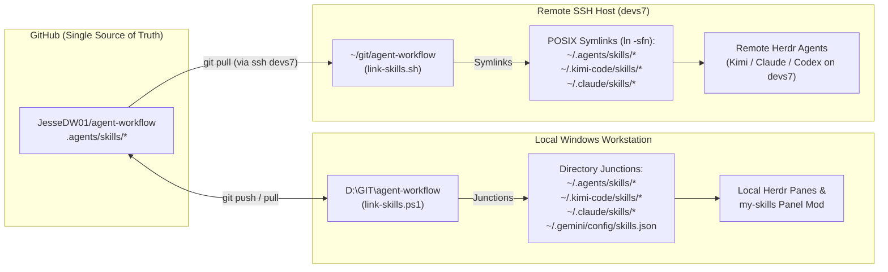

# Central Skill Management & Multi-Host Linking (Windows + Herdr + SSH `devs7`)

This document explains how [`agent-workflow`](../README.md) acts as the **single source of truth** for our agent skills across:
1. **Local Windows Workstation** (`D:\GIT\agent-workflow`) running `herdr-app`, Kimi Code, Claude Code, and Antigravity.
2. **Remote SSH Host (`devs7`)** where Herdr's remote runtime (`herdr-core` / `hc`) and remote coding agents execute in Linux terminals.

---

## 1. Architecture: How Herdr Discovers Skills Locally & Over SSH

When you open a workspace in **Herdr**:
- **Local Panes (Windows):** Agents run as child processes of your local user (`C:\Users\Jesse`) and scan user-level skill directories on Windows (`~/.agents/skills`, `~/.kimi-code/skills`, `~/.claude/skills`, `~/.gemini/config/skills.json`).
- **Remote SSH Panes (`devs7`):** Herdr connects to `herdr-core` (`hc`) running on `devs7`. Agents spawned in a `devs7` workspace run *on `devs7`* and scan the user-level skill directories in **`devs7`'s `$HOME`** (`/home/<user>/.agents/skills`, `/home/<user>/.kimi-code/skills`, `/home/<user>/.claude/skills`).



---

## 2. Why Junctions & Symlinks (Instead of File Copies)

1. **Zero Drift:** Every user-scope skill folder (`~/.agents/skills/ado-backlog-orchestrator`, etc.) is a filesystem link pointing directly into the git working tree (`agent-workflow/.agents/skills/`).
2. **Instant Live Updates:** Editing a `SKILL.md` file in `agent-workflow` or running `git pull` immediately updates every agent across all repositories and Git worktrees—no copy step required unless you add a brand-new skill folder.
3. **Worktree-Agnostic:** When `ado-worktree-worker` or `herdr worktree create` spins up a fresh worktree for another project (e.g., `../project-wt-ab-101`), the agent inside that worktree automatically sees all user-scope skills without polluting the target project's git repository.
4. **Unified Frontmatter:** Each `SKILL.md` includes `name`, `description`, `type: prompt`, and `whenToUse`, making the exact same file compatible with:
   - **Kimi Code CLI** (`/skill:<name>` and auto-invocation)
   - **Herdr `my-skills` Panel Mod** (scans `~/.agents/skills/` and `~/.kimi-code/skills/`)
   - **Claude Code CLI** (`~/.claude/skills/`)
   - **Antigravity** (`~/.gemini/config/skills.json` and `.agents/skills/`)

---

## 3. Daily Commands

### A. Link Skills Locally on Windows
From `D:\GIT\agent-workflow`:
```powershell
.\link-skills.ps1
```
This creates Windows Directory Junctions (no Administrator privileges required) in:
- `C:\Users\Jesse\.agents\skills\`
- `C:\Users\Jesse\.kimi-code\skills\`
- `C:\Users\Jesse\.claude\skills\`
- `C:\Users\Jesse\.gemini\config\skills.json`

### B. Push Changes & Sync to `devs7` in One Step
After committing new or updated skills in `D:\GIT\agent-workflow`:
```powershell
git push
.\link-skills.ps1 -RemoteHost devs7
```
Passing `-RemoteHost devs7` connects via SSH to `devs7`, clones or fast-forward pulls `https://github.com/JesseDW01/agent-workflow.git` into `~/git/agent-workflow`, and executes [`link-skills.sh`](../link-skills.sh) on `devs7`.

### C. Running directly on `devs7` (Linux / macOS)
If you are already inside an SSH session or Herdr terminal on `devs7`:
```bash
cd ~/git/agent-workflow
git pull
./link-skills.sh
```

---

## 4. Combining with `herdr-mods`

Our two repositories have cleanly separated responsibilities:
- **[`JesseDW01/herdr-mods`](https://github.com/JesseDW01/herdr-mods):** Owns Herdr desktop UI customizations (`mods/`, `layouts/`, `keys.json`, `themes/`) and the `herdr-modding` skill.
- **[`JesseDW01/agent-workflow`](https://github.com/JesseDW01/agent-workflow):** Owns the multi-agent engineering workflow (`FLOW.md`, `azure-devops-dev-flow.md`) and cross-project agent skills (`ado-backlog-orchestrator`, `ado-worktree-worker`, `ado-pr-reviewer`).

Because both install/link into `~/.kimi-code/skills` and `~/.agents/skills` using distinct skill folder names, they coexist in the same user skill directories without overwriting each other.
