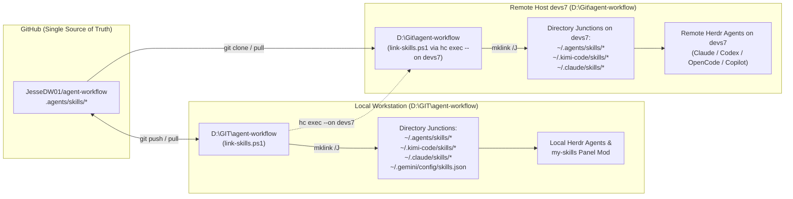

# Central Skill Management & Multi-Host Linking (Local Windows + Herdr `hc` + `devs7`)

This document explains how [`agent-workflow`](../README.md) acts as the **single source of truth** for our agent skills across:
1. **Local Windows Workstation** (`D:\GIT\agent-workflow`) running `herdr-app`, `herdr-core` (`hc`), Kimi Code, Claude Code, OpenCode, and Antigravity.
2. **Remote SSH Host (`devs7`)** (`D:\Git\agent-workflow`, Windows Server / Dev Box connected to Herdr via `hc`) where remote coding agents (`claude`, `codex`, `opencode`, `copilot`) execute in persistent Herdr terminals.

---

## 1. Architecture: How Herdr Discovers Skills Locally & on `devs7`

When you open a workspace in **Herdr**:
- **Local Panes:** Agents run under your local user (`C:\Users\Jesse`) and scan user-level skill directories (`~/.agents/skills`, `~/.kimi-code/skills`, `~/.claude/skills`, `~/.gemini/config/skills.json`).
- **Remote `devs7` Panes:** Herdr connects to `herdr-core` (`hc`) running on `devs7`. Agents spawned in a `devs7/*` workspace run *on `devs7`* under `C:\Users\800xADeveloper` and scan the user-level skill directories on **`devs7`** (`~/.agents/skills`, `~/.kimi-code/skills`, `~/.claude/skills`).



---

## 2. Why Directory Junctions (Instead of File Copies)

1. **Zero Drift:** Every user-scope skill folder (`~/.agents/skills/ado-backlog-orchestrator`, etc.) is a filesystem junction pointing directly into the git working tree (`agent-workflow/.agents/skills/`).
2. **Instant Live Updates:** Editing a `SKILL.md` file in `agent-workflow` or running `git pull` immediately updates every agent across all repositories and Git worktrees—no copy step required unless you add a brand-new skill folder.
3. **Worktree-Agnostic:** When `ado-worktree-worker` spins up a fresh Git worktree for another project (e.g., `D:\Git\GlobalConversionTools-wt-ab-101`), the agent inside that worktree automatically sees all user-scope skills without polluting the target project's git repository.
4. **Unified Frontmatter:** Each `SKILL.md` includes `name`, `description`, `type: prompt`, and `whenToUse`, making the exact same file compatible with:
   - **Kimi Code CLI** (`/skill:<name>` and auto-invocation)
   - **Herdr `my-skills` Panel Mod** (scans `~/.agents/skills/` and `~/.kimi-code/skills/`)
   - **Claude Code / Codex / OpenCode** (`~/.claude/skills/` and `~/.agents/skills/`)
   - **Antigravity** (`~/.gemini/config/skills.json` and `.agents/skills/`)

---

## 3. Daily Commands

### A. Link Skills Locally
From `D:\GIT\agent-workflow`:
```powershell
.\link-skills.ps1
```
This creates Windows Directory Junctions (no Administrator privileges required) in:
- `~/.agents/skills/`
- `~/.kimi-code/skills/`
- `~/.claude/skills/`
- `~/.gemini/config/skills.json`

### B. Push Changes & Sync to `devs7` via Herdr Core (`hc`)
Because Herdr Core (`hc`) already maintains an authenticated persistent connection to `devs7` (`hc machine ls`), you don't even need raw SSH keys—`link-skills.ps1 -RemoteHost devs7` uses `hc exec --on devs7` directly:
```powershell
git push
.\link-skills.ps1 -RemoteHost devs7
```
This command:
1. Updates all local Windows junctions.
2. Uses `hc exec --on devs7` to clone (or `git pull --ff-only`) `https://github.com/JesseDW01/agent-workflow.git` into `D:\Git\agent-workflow` on `devs7`.
3. Runs `D:\Git\agent-workflow\link-skills.ps1` on `devs7` so every remote Herdr terminal on `devs7` has the exact same junctions.

### C. Linux / macOS Remotes (Optional)
If you ever add a Linux or macOS machine to Herdr Core, run [`link-skills.sh`](../link-skills.sh) on that host to create POSIX symlinks (`ln -sfn`) in the same user-scope directories.

---

## 4. Combining with `herdr-mods`

Our two repositories have cleanly separated responsibilities:
- **[`JesseDW01/herdr-mods`](https://github.com/JesseDW01/herdr-mods):** Owns Herdr desktop UI customizations (`mods/`, `layouts/`, `keys.json`, `themes/`) and the `herdr-modding` skill.
- **[`JesseDW01/agent-workflow`](https://github.com/JesseDW01/agent-workflow):** Owns the multi-agent engineering workflow ([`FLOW.md`](../FLOW.md), [`azure-devops-dev-flow.md`](../azure-devops-dev-flow.md)) and cross-project agent skills (`ado-backlog-orchestrator`, `ado-worktree-worker`, `ado-pr-reviewer`).

Because both install/link into `~/.kimi-code/skills` and `~/.agents/skills` using distinct skill folder names, they coexist in the same user skill directories without overwriting each other.
